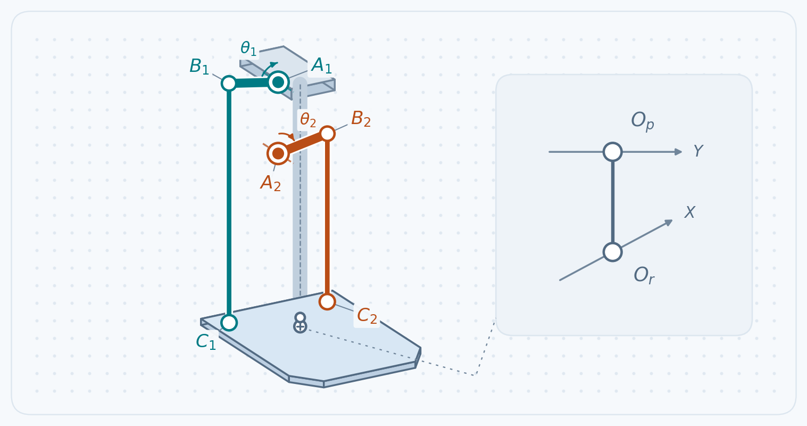
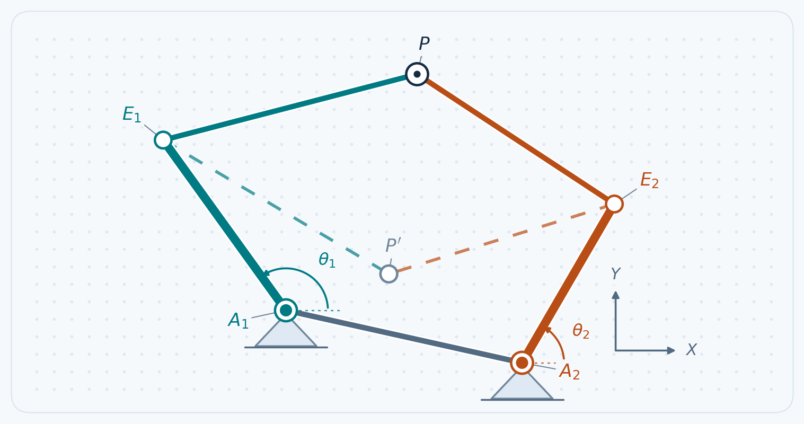
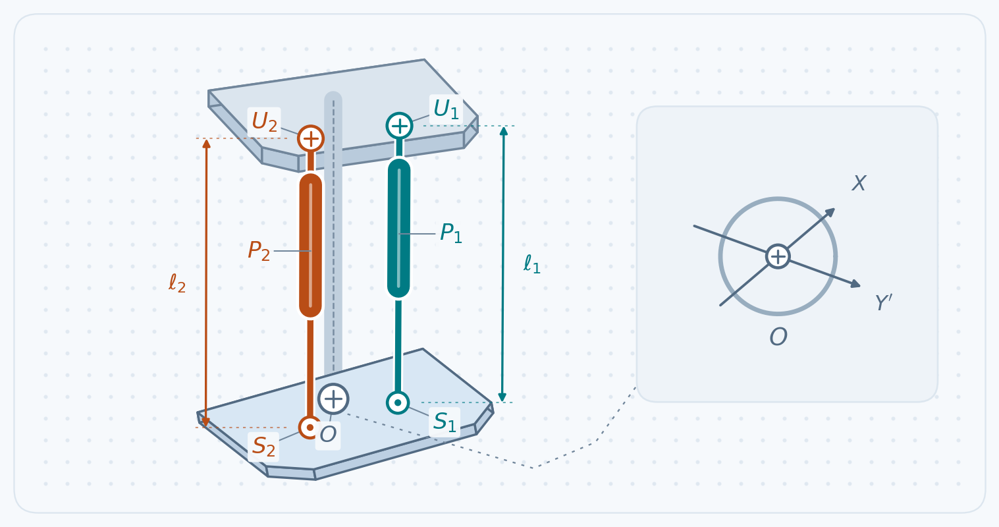

# ParallelAnkleSolver

**English** · [简体中文](README.zh-CN.md)

Kinematics for parallel ankles and closed-loop leg mechanisms in bipedal robots. The core is a standalone C++17 library built on Eigen3. YAML configuration support is optional.

## Mechanism configurations

### Dual rotary-drive ankle



Motors at `A₁` and `A₂` drive cranks `AᵢBᵢ`. The fixed-length rods `BᵢCᵢ` transmit their motion to the footplate. The inset shows the pitch center `O_p` and roll center `O_r` at the neutral pose of `rotary_reference`. `PMAnkle` uses `[pitch, roll]` and the rotation product `Ry(pitch) Rx(roll)`. [Crank and rod geometry](docs/model.md)

### Planar five-bar



The fixed base `A₁A₂`, two driven links, and two distal links form the closed loop. Motor angles `θ₁` and `θ₂` locate elbows `E₁` and `E₂`. The distal links can meet at `P` or `P′`, giving two assembly modes for the same motor angles. `PlanarFiveBar` uses the planar foot position `[x, y]` as its task coordinate. The diagram uses the asymmetric `five_bar_demo` geometry. [Five-bar coordinates and branches](docs/backends.md#一般平面五杆)

### Dual linear-drive spatial ankle



From base to footplate, each leg runs through a universal joint `Uᵢ`, a prismatic actuator `Pᵢ`, and a spherical joint `Sᵢ`. The actuators control leg lengths `ℓ₁` and `ℓ₂`. The central universal joint constrains the footplate to two-axis rotation about `O`. The example uses `[roll, pitch]` and `Rx(roll) Ry(pitch)`. [Spatial ankle example](docs/research/linear_universal_ankle.md)

## Features

- Analytical inverse kinematics for the rotary ankle, from foot pose to both motor angles.
- Numerical forward kinematics with a configurable initial guess, iteration cap, and convergence status.
- An analytical closure Jacobian, an independent finite-difference reference, and velocity and torque mappings between task and motor coordinates.
- Full motor stiffness and damping matrices that retain cross-axis coupling.
- Optional motor-angle Hessians and a static loaded stiffness mapping.
- Separate pitch and roll centers, with configurable foot geometry, motor directions, and zero offsets.
- Regression tests for both rotary ankle examples and a separate reference geometry.
- Multi-branch five-bar FK and IK, its A/B constraint Jacobians, and singularity diagnostics.
- Full-circle fixed-axis crank phases and prismatic lengths with stroke limits.
- Damped local solves for Euclidean equality constraints, with variable and residual scaling and consistency-checked implicit differentiation.

## Quick start

The core requires CMake 3.16 or later, a C++17 compiler, and Eigen3. The default build also uses yaml-cpp and GoogleTest. On Ubuntu, the corresponding packages are `libeigen3-dev`, `libyaml-cpp-dev`, and `libgtest-dev`. The build uses locally installed dependencies.

The verification scripts require Python 3, `flock` from util-linux, `free`, `uptime`, and `ps` from procps, and `rg` from ripgrep. Run this command from the repository root.

```bash
./scripts/check.sh
```

The script acquires the shared resource lock, checks available memory and load, builds with at most two workers, runs tests serially, and exercises three configuration examples. It returns status 75 when resources are busy.

Set `PARALLEL_ANKLE_LOCK_WAIT_SECONDS=60` to wait for the lock. The default is zero seconds and the maximum is 3600. Builds and tests start after lock acquisition.

Run individual examples from the repository root.

```bash
./build/ankle_demo configs/rotary_ankle.yaml          # Defaults to rotary_v02
./build/ankle_demo configs/rotary_ankle.yaml rotary_v01
./build/ankle_demo configs/rotary_ankle_reference.yaml
./build/five_bar_demo
./build/constraints_demo
./build/transmissions_demo
./build/loaded_stiffness_demo
./build/linear_universal_ankle_demo
```

The ankle demo runs IK followed by FK for each foot and prints the motor angles, recovered pose, residual, and Jacobian. The other examples cover five-bar branches, local closure constraints, rotary and prismatic legs, and static preload. `linear_universal_ankle_demo` combines the library primitives to model two linear actuators and a central universal joint. [Backend coordinate conventions and solver scope](docs/backends.md)

## Choosing a backend

| Backend | Input or task coordinate | Solution scope |
| --- | --- | --- |
| `PMAnkle` | Pitch and roll angles | Fixed-branch IK and local FK |
| `PlanarFiveBar` | Planar foot point or two motor angles | Up to 4 IK solutions and 2 FK solutions with explicit branches |
| `SolveRotaryRod` | 3D attachment point | Arbitrary fixed axis and up to 2 phase families modulo 2π |
| `SolvePrismaticLength` | 3D attachment point | Leg length, stroke check, and direction gradient |
| `SolveEqualities` | User-supplied equations and initial state | Local Euclidean constraint solve with bounds and rank diagnostics |

`./scripts/check_all.sh --benchmark` exercises installed and embedded consumers and runs a short benchmark. `./scripts/check_sanitizers.sh` runs address and undefined-behavior checks with GCC or Clang. Both scripts use the shared resource lock. [Coordinates and units for each backend](docs/backends.md)

`./scripts/check_lock_protocol.sh` uses a separate temporary lock to check descriptor inheritance and lock release on exit. The resource-aware build scripts perform the host headroom checks.

## Using the library in C++

```cpp
#include <stdexcept>
#include <parallel_ankle/config.h>
#include <parallel_ankle/parallel_ankle.h>

const auto config = parallel_ankle::LoadAnkleConfig("configs/rotary_ankle.yaml");
const parallel_ankle::PMAnkle left_ankle(true, config.left);
const auto ik = left_ankle.GetAnkleMotorAngles(0.1, 0.05);
if (!ik.success()) {
    throw std::runtime_error("unreachable ankle pose");
}

parallel_ankle::ForwardOptions options;
options.initial_guess = {0.0, 0.0};  // Use the previous pose for continuous feedback.
const auto fk = left_ankle.SolveForwardKinematics(ik.theta_1_rad, ik.theta_2_rad, options);
if (!fk.success()) {
    throw std::runtime_error(parallel_ankle::ToString(fk.status));
}
// fk.pose = [pitch, roll]
```

For a CMake subproject, link the optional configuration component as follows.

```cmake
set(PARALLEL_ANKLE_BUILD_TESTS OFF CACHE BOOL "" FORCE)
set(PARALLEL_ANKLE_BUILD_EXAMPLES OFF CACHE BOOL "" FORCE)
add_subdirectory(path/to/ParallelAnkleSolver)
target_link_libraries(your_target PRIVATE ParallelAnkle::config)
```

If you construct `AnkleParams` directly, link `ParallelAnkle::core`. Set `PARALLEL_ANKLE_WITH_YAML=OFF` for a core-only build. For an installed package, run `cmake --install build --prefix "$PWD/install"`. Request `find_package(ParallelAnkle CONFIG REQUIRED COMPONENTS core)` for the Eigen-only core or request the `config` component for YAML loading. `ParallelAnkle_CONFIG_DIR` points to the installed configuration files.

Subproject builds omit examples and tests by default. Enabling tests also enables GoogleTest discovery.

## Parameters and conventions

| Configuration | Crank length | Roll / pitch center Z | Use |
| --- | --- | --- | --- |
| `rotary_v02` (default) | 30 mm | −15 / −5 mm | Current example geometry |
| `rotary_v01` | 60 mm | 3 / 3 mm | Earlier example geometry |
| `rotary_reference` | 60 mm | 0 / 10 mm | Regression test geometry |

The loader reads `ankle_params` from the selected profile. The default profile name is `robot_type + "_" + version`.

For the rotary ankle, angles are in radians. Task coordinates use `[pitch, roll]` and motor coordinates follow wiring order `[motor1, motor2]`. The sample geometries use millimeters. Keep all positions and lengths in one unit within a model. The rotary angle-to-angle closure is scale-normalized, so uniform length scaling preserves angles and the Jacobian. Other backends use their own units, such as `rad/length` for the five-bar and `length/rad` for the linear-drive ankle example.

`is_left_motor1/2` determines each motor direction. When the flag is `false`, the solver negates the analytical crank angle before adding `alpha_*_rad`. `PMAnkle::is_left()` identifies the foot side. Supply each foot with its own parameters.

## Solver results and limits

For an unreachable pose or nonfinite input, the affected actuator returns a false `success_*` flag and a NaN angle. `status_1/2` identifies invalid input, unreachable closure, undefined crank angle, a result outside the selected branch, or a numerical representation failure. The decoded motor angle must recover the selected crank angle within `1e-12 rad` and satisfy rod closure on the selected working root. Closure tolerance is relative to the rod length. A stable half-angle path handles small openings with short rods. Check the status of both actuators.

FK returns the pose, convergence status, stable residual norm, and iteration count. On failure the pose is the final iterate. `GetAnklePoseFromMotorAngles()` throws when the forward solve fails.

The Jacobian is `J = d(theta) / d([pitch, roll])`. `ComputeJacobian(pitch, roll)` differentiates the rod closure analytically. `ComputeNumericalJacobian(pitch, roll, eps)` is the independent finite-difference reference. The three-argument `ComputeJacobian(pitch, roll, eps)` overload calls that numerical version. The analytic derivative reports actuator transmission singularities. Inverse mapping interfaces require a full-rank Jacobian. The stiffness and damping matrix interfaces use the local unloaded linearization.

The optional `second_order.h` API calculates motor-angle Hessians and geometric stiffness from static preload. It accepts a full symmetric task matrix and reports whether the motor stiffness is positive semidefinite. Its scope is static stiffness around the current pose. [Second-order mapping](docs/research/second_order_transmission.md)

The rotary ankle solver uses a fixed crank branch and checks the sine, cosine, and rod length to resolve the branch. The sign of `C.y - A.y` at the neutral pose determines the crank side and must be nonzero. Forward kinematics uses local Newton iterations with backtracking. The model covers the selected assembly branch, with travel and collision limits outside the modeled geometry. The tests cover finite samples of the supplied geometries.

## Repository layout

```text
include/parallel_ankle/  Public parameters, solvers, and configuration interfaces
src/                    Solver implementation and optional YAML loader
configs/                Example rotary ankle geometries
examples/               Runnable examples
tests/                 Closure, IK/FK, mapping, and failure-state checks
docs/                  Model documentation and research index
scripts/check.sh        Resource-aware build and verification entry point
```

See the mechanism derivation and the independent high-precision derivative check. [Mechanism model](docs/model.md) · [Jacobian convergence check](tools/validation/JACOBIAN_CONVERGENCE.md)

## Parallel leg mechanism research

The research index covers planar five-bar legs, symmetric coaxial mechanisms, parallel ankles and knees, and mixed serial-parallel legs. It reviews HyRoDyn, the Gepetto toolbox, TriP, GRBDA, and RoboCompiler and records paper availability, software licenses, capabilities, and reproduction status. [Papers, implementations, and integration approaches](docs/research/README.md)

The native backends have finite-sample tests for geometry, branches, derivatives, and failure states. The Doggo regression covers planar geometry and the virtual-leg Jacobian from the public firmware. Hardware and encoder calibration require their own validation. The research index records the integration status of each external framework.
