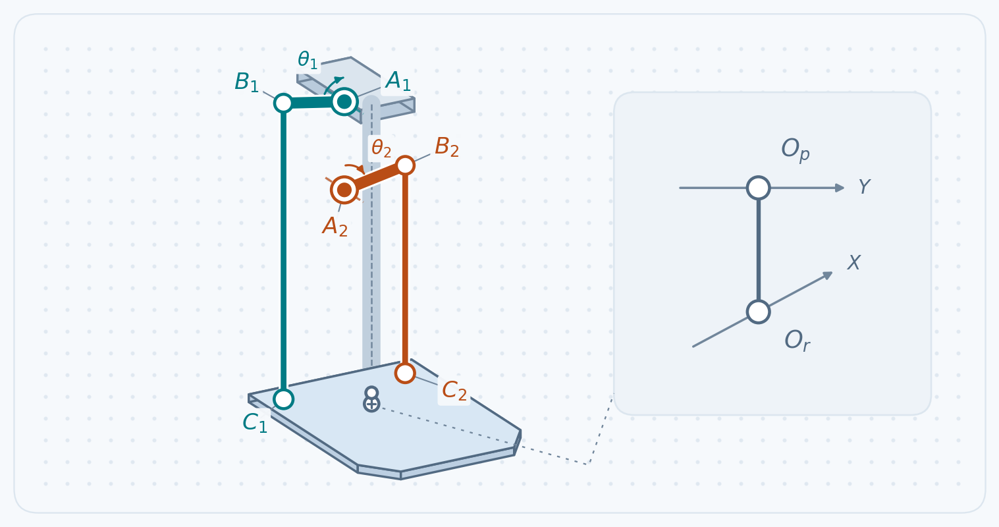
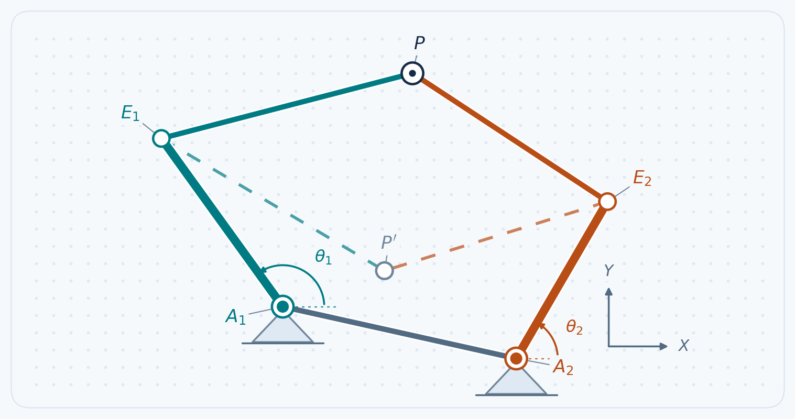
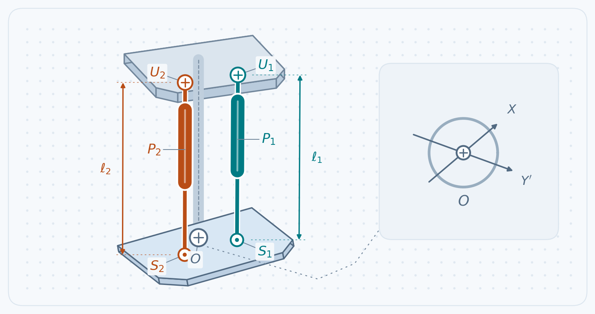

# ParallelAnkleSolver

[English](README.md) · **简体中文**

双足机器人并联脚踝与腿部闭环机构求解库。旋转驱动脚踝由两路电机驱动曲柄和定长连杆，任务自由度为 **pitch / roll**。

核心使用 **C++17 + Eigen3**，可单独编译；YAML 配置加载器为可选组件。

## 三种机构构型

### 双旋转驱动脚踝



两个固定电机位于 `A₁`、`A₂`，分别带动曲柄 `AᵢBᵢ`。两根定长连杆 `BᵢCᵢ` 把运动传给脚板。右图放大 `rotary_reference` 零位的俯仰中心 `O_p` 和横滚中心 `O_r`。`PMAnkle` 的任务坐标为 `[pitch, roll]`，转动顺序为 `Ry(pitch) Rx(roll)`。[曲柄与连杆几何](docs/model.md)

### 平面五杆



固定基座 `A₁A₂` 与左右各一根主动杆和一根远端杆构成五杆闭环。两个电机角 `θ₁`、`θ₂` 决定肘点 `E₁`、`E₂`。远端杆的两个可能交点 `P`、`P′` 对应同一组电机角下的两个装配分支。`PlanarFiveBar` 的任务坐标为足端位置 `[x, y]`。图中采用 `five_bar_demo` 的非对称几何。[五杆坐标和分支](docs/backends.md#一般平面五杆)

### 双直线驱动空间脚踝



每条支链从基座到脚板依次经过万向节 `Uᵢ`、伸缩副 `Pᵢ` 和球铰 `Sᵢ`，执行器控制长度 `ℓ₁`、`ℓ₂`。中心万向节的两根转轴交于 `O`，约束脚板绕 `O` 做两自由度转动。组合示例使用 `[roll, pitch]` 和 `Rx(roll) Ry(pitch)`。[空间脚踝示例](docs/research/linear_universal_ankle.md)

## 已有功能

- 解析逆运动学：脚踝姿态 → 两个电机角度。
- 数值正运动学：电机角度 → 脚踝姿态，支持初值、迭代上限和收敛状态。
- 闭环约束的解析雅可比、独立数值差分参考，以及电机/任务空间的速度、力矩转换。
- 任务空间刚度、阻尼到完整电机矩阵的转换，保留交叉耦合项。
- 可选的电机角 Hessian 与带静态预载的完整刚度矩阵映射。
- 独立的 pitch / roll 旋转中心，以及左右脚、电机方向和零位偏移配置。
- 两组旋转脚踝示例参数及独立测试参数的回归验证。
- 一般平面五杆的多分支 FK/IK、A/B 约束雅可比与奇异性诊断。
- 任意固定轴曲柄—连杆的完整圆周相位分支，以及带行程限制的直线长度原语。
- 欧氏等式约束的带阻尼局部求解、变量/残差尺度与相容性受检的隐式微分。

## 快速开始

依赖：CMake ≥ 3.16、C++17 编译器、Eigen3；默认构建还使用 yaml-cpp 和 GoogleTest。对应 Ubuntu 软件包为 `libeigen3-dev`、`libyaml-cpp-dev`、`libgtest-dev`。构建过程不下载依赖。

验证脚本另需 Python3、`flock`（util-linux）、`free/uptime/ps`（procps）与 `rg`（ripgrep）。在仓库根目录运行。

```bash
./scripts/check.sh
```

脚本持有跨对话排他锁，检查内存与负载，以最多 2 个编译 worker 构建，串行执行测试，然后运行三组配置的示例。资源忙时以状态码 75 返回，表示推迟执行。

需要等待锁时可设置 `PARALLEL_ANKLE_LOCK_WAIT_SECONDS=60`（默认不等待，最大 3600 秒）。锁等待期间不运行编译或测试。

单独运行示例：

```bash
./build/ankle_demo configs/rotary_ankle.yaml          # 默认 rotary_v02
./build/ankle_demo configs/rotary_ankle.yaml rotary_v01
./build/ankle_demo configs/rotary_ankle_reference.yaml
./build/five_bar_demo
./build/constraints_demo
./build/transmissions_demo
./build/loaded_stiffness_demo
./build/linear_universal_ankle_demo
```

脚踝示例对左右脚分别执行 IK → FK，并输出电机角度、还原姿态、残差和雅可比。其他示例演示五杆分支、局部闭环约束、旋转/直线支链和静态预载映射。`linear_universal_ankle_demo` 组合现有接口，演示两条长度执行器与中心万向节的空间脚踝。后端坐标、单位及局部求解范围见 [backends.md](docs/backends.md)。

## 后端选择

| 后端 | 输入/任务坐标 | 解的范围 |
| --- | --- | --- |
| `PMAnkle` | pitch/roll 角 | 固定分支 IK、局部 FK |
| `PlanarFiveBar` | 足端二维位置或两电机角 | 最多 4 组 IK / 2 组 FK，显式分支 |
| `SolveRotaryRod` | 三维连接点 | 任意固定轴、最多 2 个模 2π 相位族 |
| `SolvePrismaticLength` | 三维连接点 | 支链长度、行程和方向梯度 |
| `SolveEqualities` | 用户的闭环方程与初值 | 局部欧氏约束解、边界与秩诊断 |

各模型的完整坐标与单位约定见 [backends.md](docs/backends.md)。安装/嵌入消费与可选短时基准入口为 `./scripts/check_all.sh --benchmark`；GCC/Clang 的地址/未定义行为检查入口为 `./scripts/check_sanitizers.sh`。这些脚本都使用相同共享锁。

资源锁的轻量协议检查为 `./scripts/check_lock_protocol.sh`，仅使用独立临时锁验证继承和退出释放，不执行编译或数值计算；它不替代实际资源余量检查。

## 在 C++ 中使用

```cpp
#include <stdexcept>
#include <parallel_ankle/config.h>
#include <parallel_ankle/parallel_ankle.h>

const auto config = parallel_ankle::LoadAnkleConfig("configs/rotary_ankle.yaml");
const parallel_ankle::PMAnkle left_ankle(true, config.left);
const auto ik = left_ankle.GetAnkleMotorAngles(0.1, 0.05);
if (!ik.success()) {
    throw std::runtime_error("unreachable ankle pose");
}

parallel_ankle::ForwardOptions options;
options.initial_guess = {0.0, 0.0};  // 连续反馈可使用上一帧姿态
const auto fk = left_ankle.SolveForwardKinematics(ik.theta_1_rad, ik.theta_2_rad, options);
if (!fk.success()) {
    throw std::runtime_error(parallel_ankle::ToString(fk.status));
}
// fk.pose = [pitch, roll]
```

CMake 子项目可以使用：

```cmake
set(PARALLEL_ANKLE_BUILD_TESTS OFF CACHE BOOL "" FORCE)
set(PARALLEL_ANKLE_BUILD_EXAMPLES OFF CACHE BOOL "" FORCE)
add_subdirectory(path/to/ParallelAnkleSolver)
target_link_libraries(your_target PRIVATE ParallelAnkle::config)
```

直接用 `AnkleParams` 构造参数时，链接 `ParallelAnkle::core` 即可。设置 `PARALLEL_ANKLE_WITH_YAML=OFF` 可以完全去掉 yaml-cpp 依赖。也支持 `cmake --install build --prefix "$PWD/install"`。安装后使用 `find_package(ParallelAnkle CONFIG REQUIRED COMPONENTS core)` 时无需 yaml-cpp；需要加载器时请求 `COMPONENTS config`。安装配置路径为 `ParallelAnkle_CONFIG_DIR`。

作为 CMake 子项目时默认关闭示例和测试，不额外查找 GoogleTest。

## 参数与约定

| 配置 | 曲柄长度 | Roll / Pitch 中心 Z | 用途 |
| --- | --- | --- | --- |
| `rotary_v02`（默认） | 30 mm | −15 / −5 mm | 当前示例几何 |
| `rotary_v01` | 60 mm | 3 / 3 mm | 早期示例几何 |
| `rotary_reference` | 60 mm | 0 / 10 mm | 回归测试几何 |

加载器读取所选 profile 的 `ankle_params`。默认 profile 来自 `robot_type + "_" + version`。

旋转脚踝的所有角度为 rad，关节顺序固定为 `[pitch, roll]`，电机顺序为 `[motor1, motor2]`。示例几何参数使用 mm；同一模型的全部长度和坐标应使用同一单位。该角度到角度的闭环方程经过尺度归一化，统一缩放不改变角度和雅可比。其他后端分别定义任务坐标和雅可比单位，例如五杆为 `rad/长度`，线性驱动空间示例为 `长度/rad`，按各自模型说明使用。

电机方向由 `is_left_motor1/2` 决定：为 `false` 时先对解析角取反，再加 `alpha_*_rad`。`PMAnkle` 的 `is_left` 只标记脚侧，不额外改变符号。左右脚需要各自提供参数。

## 求解结果与边界

IK 不可达或输入非有限值时，对应 `success_*` 为 `false`，角度为 NaN。`status_1/2` 区分非法输入、不可达、曲柄角未定义、超出当前装配分支与数值表示失败。电机输出减去零偏后必须在 `1e-12 rad` 内恢复所选曲柄角，并继续满足杆长与选定工作根；有限零偏若抹去有效角度或切换到另一闭合根，也会返回失败。杆长复核按连杆自身长度计容差，短杆开角有稳定半角恢复路径。应检查两个执行器的状态。FK 返回收敛状态、稳定范数残差、迭代次数和姿态；失败时姿态仅为最后一次迭代值。兼容方法 `GetAnklePoseFromMotorAngles()` 在失败时抛出异常。

雅可比的定义为 `J = d(theta) / d([pitch, roll])`。`ComputeJacobian(pitch, roll)` 从杆长闭环直接求导；`ComputeNumericalJacobian(pitch, roll, eps)` 提供独立差分参考。原有显式三参数 `ComputeJacobian(pitch, roll, eps)` 仍调用数值版本。执行器传动奇异时解析导数报错；涉及逆映射的接口也会拒绝秩亏矩阵。原刚度/阻尼矩阵接口对应无预载下的局部线性化。

另行请求的 `second_order.h` 接口计算电机角 Hessian 与静态预载几何刚度，接受完整对称任务矩阵，报告电机矩阵是否半正定。它不包含运动中 PD 控制的速度项；公式、符号和使用范围见[二阶映射说明](docs/research/second_order_transmission.md)。

旋转脚踝使用固定曲柄分支，检查正弦、余弦及杆长，拒绝 `asin` 折叠造成的伪解。曲柄物理侧由零位 `C.y - A.y` 的符号确定；该差为零的机构不在此模型支持范围。正解使用带回溯的局部 Newton 迭代。其他装配分支、全工作空间多解、电机/关节限位与碰撞约束尚未建模。现有测试验证给定配置中的有限采样点。

## 目录

```text
include/parallel_ankle/  公共参数、求解器、配置接口
src/                    求解实现与可选 YAML 加载器
configs/                旋转脚踝示例几何
examples/               可运行示例
tests/                  几何闭环、正逆解、映射与失败状态测试
docs/                   模型说明和研究索引
scripts/check.sh        遵守整机资源约定的构建与验证入口
```

模型公式见[机构模型](docs/model.md)。高精度导数核对见[雅可比收敛验证](tools/validation/JACOBIAN_CONVERGENCE.md)。


## 腿部并联构型研究

已整理[论文、开源实现与适配路线](docs/research/README.md)，涵盖一般五杆腿、同轴对称并联腿、并联脚踝/膝和多闭环混合腿。重点核查 HyRoDyn、Gepetto 工具箱、TriP、GRBDA 与 RoboCompiler，并分别记录论文公开状态、代码许可证、实际能力和本仓库复现状态。

原生后端已通过有限采样的几何、分支、导数与失败状态测试。Doggo 回归核对的是公开固件中的平面几何和虚拟腿雅可比，不能据此推断原始编码器、整机或其他机器人已完成硬件适配。外部框架尚未接入或复现。
